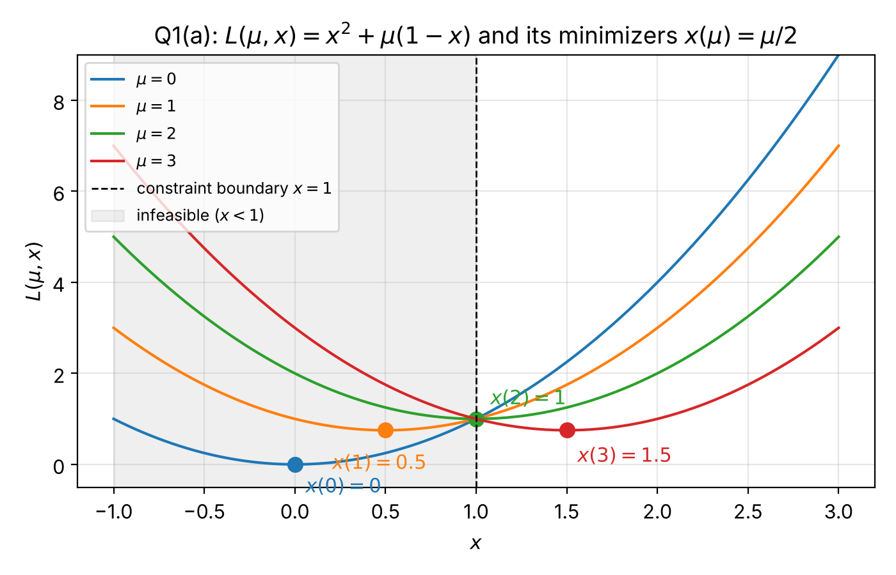
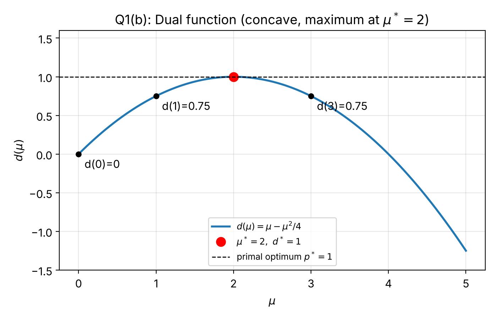
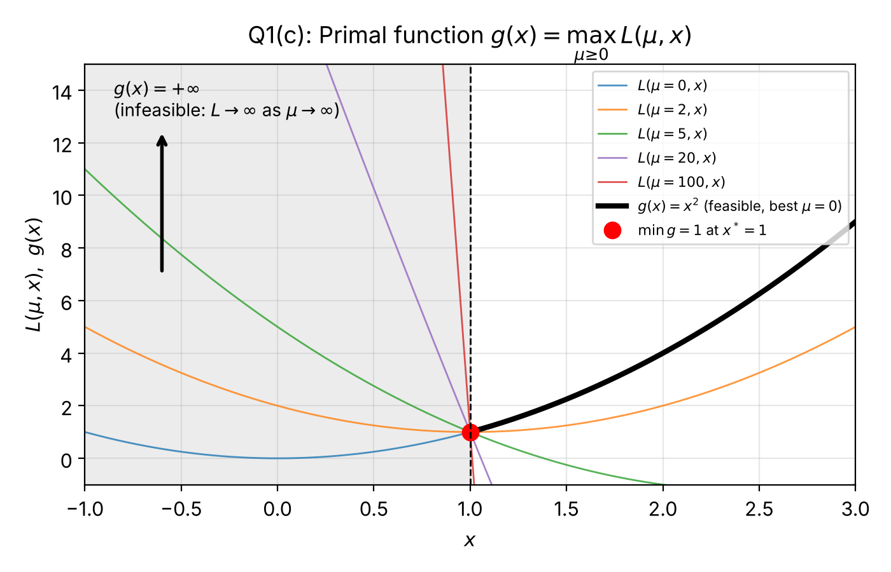
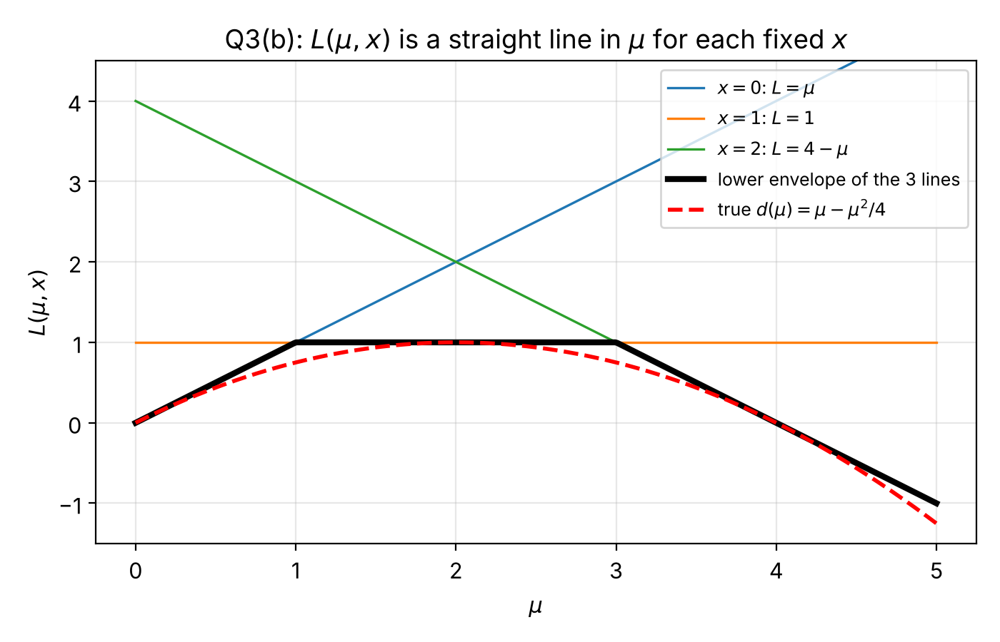
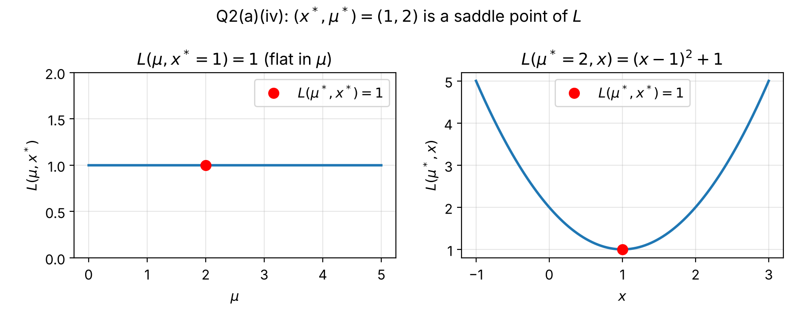

# Lagrangian Duality, Saddle Points and Weak Duality

EN3330 – Introduction to Engineering Optimization, Assignment 03
University of Moratuwa, Department of Electronic and Telecommunication Engineering

**Author:** Ranaweera R.P.D.D.H. (220511N)

## Problem

All questions study the constrained problem

    minimise  x²   subject to  x ≥ 1,

with the constraint written as `h(x) = 1 − x ≤ 0` and the Lagrangian

    L(μ, x) = x² + μ(1 − x),   μ ≥ 0.

## Key results

| Quantity | Result |
|---|---|
| Minimiser of L for fixed μ | x(μ) = μ/2 |
| Dual function | d(μ) = μ − μ²/4 |
| Dual optimum | μ* = 2, d* = 1 |
| Primal function | g(x) = x² for x ≥ 1, +∞ for x < 1 |
| Primal optimum | x* = 1, p* = 1 (zero duality gap) |
| Saddle point | (x*, μ*) = (1, 2), with L(μ*, x) = (x − 1)² + 1 |
| Constraint changed to x ≥ −1 | x* = 0, constraint inactive, μ* = 0 |

## Repository layout

```
report/   220511N_EN3330_A03.pdf   final submitted report
figures/  Q1a, Q1b, Q1c, Q2a, Q3b  plots used in the report (PNG)
src/      en3330_a03_plots.py      generates all figures
          build_report.py          assembles the report PDF
source/   answers_handwritten.pdf  handwritten answers (input to build_report.py)
```

## How to reproduce

```bash
pip install -r requirements.txt
python src/en3330_a03_plots.py   # writes the PNGs into figures/
python src/build_report.py       # writes report/220511N_EN3330_A03.pdf
```

## Figures

| | |
|---|---|
|  |  |
| L(μ, x) vs x and its minimisers | Dual function d(μ) |
|  |  |
| Primal function g(x) | Lower envelope of lines in μ |


Saddle point check at (x*, μ*) = (1, 2)
